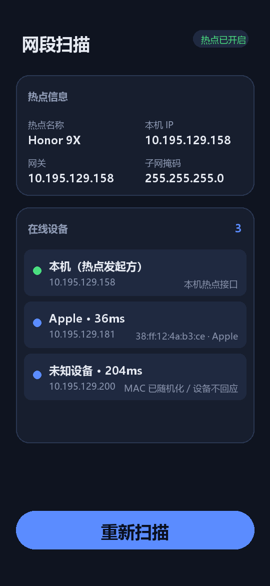

# LanScope

<p align="center">
  
</p>

<p align="center">
  <b>Android 热点网段扫描器 · 扫出谁连着你的手机热点</b>
</p>

<p align="center">
  
  
  
  
</p>

---

## 这是什么

**LanScope**（网段扫描）是一个 Android 应用：开启手机热点后，一键扫描并展示**当前连入热点的所有设备**的网段信息——IP 地址、MAC 地址、设备厂商、响应延迟，以及热点本身的名称、本机 IP、网关、子网掩码。

简单说，它就是手机热点版的「局域网设备扫描器」：想知道有几个设备蹭你的网、它们都是什么，打开点一下就知道。

<p align="center">
  
</p>

## 有什么用

- **看谁在连你的热点**：朋友聚会、宿舍开黑，一眼看清当前几台设备在线
- **发现陌生设备**：有可疑设备蹭网时能立刻发现（IP + MAC + 厂商信息）
- **排查网络问题**：确认设备的 IP 分配情况，方便 ssh / adb 等后续连接
- **无 root 可用**：全部功能不需要 root 权限

## 怎么用

### 安装

从 [Releases](https://github.com/JinHao0007/LanScope/releases) 下载最新的 `LanScope-vX.X.apk`，传到手机上安装即可（需允许安装未知来源应用）。

> 系统提示的「位置权限」用于读取热点名称与 Wi-Fi 信息（Android 系统规定），应用不采集、不上传任何位置数据。

### 使用步骤

1. **开启热点**：系统设置里打开「移动热点」，让其他设备连上来
2. **打开 LanScope**：顶部会显示热点名称、本机 IP、网关、掩码；右上角徽章显示「热点已开启」
3. **点击「扫描网段」**：约 10 秒扫完整个 /24 网段，设备实时上屏
4. **查看结果**：每台设备显示一行——名称（厂商/主机名）、IP、MAC、延迟

### 结果说明

| 显示内容 | 含义 |
|---------|------|
| `Apple · 36ms` | 通过 MAC 前缀识别出厂商，附 TCP 响应延迟 |
| `未知设备` | 对方屏蔽了识别（MAC 随机化、无 NetBIOS/DNS 响应） |
| `本机（热点发起方）` | 你自己的手机 |
| `MAC 已随机化 / 设备不回应` | Android 10+ 默认对探针使用随机 MAC，属正常现象 |

## 技术原理

扫描分三层，全部并行执行（128 线程，/24 网段约 10 秒）：

1. **UDP 探测**（137/139 端口）—— 触发内核 ARP 解析
2. **邻居表读取** —— `ip neigh` 优先，`/proc/net/arp` 兜底，拿 IP→MAC 映射
3. **TCP 确认** —— connect 常见端口（80/443/8080/5555），RST 也算在线

设备名称三个来源依次尝试：**NetBIOS 查询**（UDP 137 直接问设备）→ **DNS 反解** → **MAC 厂商库**（内置 300+ OUI 前缀，离线可用）。

## 从源码构建

```bash
git clone https://github.com/JinHao0007/LanScope.git
cd LanScope
./gradlew assembleDebug
# 产物: app/build/outputs/apk/debug/app-debug.apk
```

需要 JDK 17+（用于 AGP 8.13）。首次构建会自动下载 Gradle 8.9。

## 项目结构

```
app/src/main/java/com/lan/scanner/
├── MainActivity.java     # 主界面、热点信息读取、权限、扫描调度
├── NetworkScanner.java   # 并行扫描引擎（UDP/ARP/TCP 三层探测）
├── ArpTableReader.java   # 内核邻居表读取（ip neigh + /proc/net/arp）
├── NbnsQuery.java        # NetBIOS 名称服务查询（UDP 137）
├── MacVendorLookup.java  # MAC OUI 厂商离线库
└── DeviceAdapter.java    # 设备列表 RecyclerView 适配器
```

## 已知限制

- 「未知设备」无法完全消除：Android 10+ 默认 MAC 随机化，若设备同时屏蔽 NetBIOS/DNS，只能看到 IP
- 热点名称在部分机型上需要打开应用 1~2 秒后才显示（系统配置同步延迟，应用内已做自动重试）
- 扫的是热点所在网段；连接他人 Wi-Fi 时也可扫该 Wi-Fi 网段，用法相同

## License

[MIT](LICENSE)
